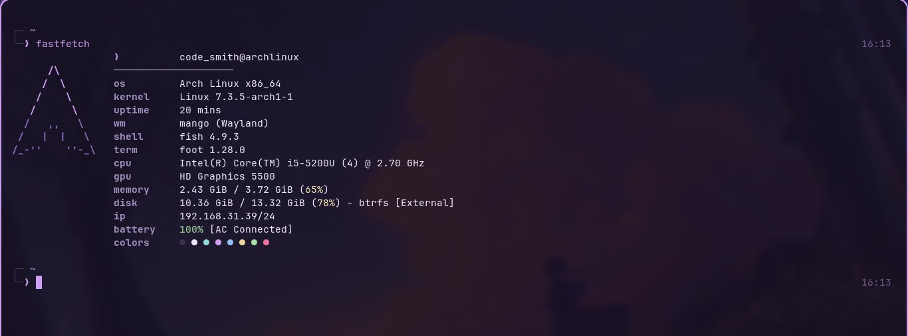
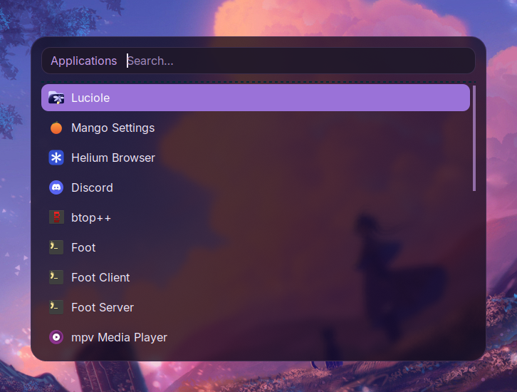

# Mangowm-Dotfiles 🥭💜

My **mangowm** rice — purple glass / "dusk plum" theme across the compositor, bar, terminal and launcher.

- **Compositor:** [mangowm](https://github.com/mangowm/mango) — blur, shadows, rounded borders, slide/zoom animations, scroller layout
- **Bar:** [mangobar](https://github.com/mangowm/mangobar) — workspaces, clock, cpu/mem/network/volume/brightness/battery, tray
- **Terminal:** [foot](https://codeberg.org/dnkl/foot) — "dusk plum" palette, translucent, blurred
- **Launcher:** [rofi](https://github.com/davatorium/rofi) — purple glass drun/run/window theme
- **Wallpapers:** included in [`wallpapers/`](wallpapers/)

## 📸 Previews

<p align="center">
  
  <br><br>
  
  <br><br>
  
</p>

## 🚀 One-liner install (everything)

```bash
curl -fsSL https://raw.githubusercontent.com/code-smith404/Mangowm-Dotfiles/main/install.sh | bash
```

That downloads the whole repo and puts every config in place:

```
~/.config/mango/          config.conf, mangowall.c, swaylock.pam
~/.config/mangobar/       config.jsonc, style.css
~/.config/foot/           foot.ini
~/.config/rofi/           config.rasi
~/.config/mango-settings/ settings.ini
~/Pictures/Wallpapers/    dusk-aurora.png, dusk-aurora-lock.png
~/.local/bin/mangowall    (built from source, if you have the deps)
```

> Lock screen needs one root command (printed by the installer):
> ```bash
> sudo install -Dm644 ~/.config/mango/swaylock.pam /etc/pam.d/swaylock
> ```

## 📦 One-liner for the required packages (Arch)

```bash
sudo pacman -S --needed mangowm foot rofi mako swaybg mangobar-git ttf-jetbrains-mono-nerd inter-font papirus-icon-theme
```

or with an AUR helper: `paru -S --needed mangowm-git mangobar-git foot rofi mako swaybg ttf-jetbrains-mono-nerd inter-font papirus-icon-theme`

(`mangobar-git` is AUR-only. On other distros, build [mangowm](https://github.com/mangowm/mango) and [mangobar](https://github.com/mangowm/mangobar) from source.)

## 🧩 Individual install commands

Prefer only one piece? Clone once, then grab what you want:

```bash
git clone https://github.com/code-smith404/Mangowm-Dotfiles && cd Mangowm-Dotfiles
```

<details open>
<summary><b>mangowm (compositor config)</b></summary>

```bash
mkdir -p ~/.config/mango
install -m644 mango/config.conf ~/.config/mango/
```

</details>

<details>
<summary><b>mangobar</b></summary>

```bash
mkdir -p ~/.config/mangobar
install -m644 mangobar/config.jsonc mangobar/style.css ~/.config/mangobar/
```

</details>

<details>
<summary><b>foot terminal</b></summary>

```bash
mkdir -p ~/.config/foot
install -m644 foot/foot.ini ~/.config/foot/
```

</details>

<details>
<summary><b>rofi</b></summary>

```bash
mkdir -p ~/.config/rofi
install -m644 rofi/config.rasi ~/.config/rofi/
```

</details>

<details>
<summary><b>wallpapers</b></summary>

```bash
mkdir -p ~/Pictures/Wallpapers
install -m644 wallpapers/dusk-aurora.png wallpapers/dusk-aurora-lock.png ~/Pictures/Wallpapers/
```

</details>

<details>
<summary><b>mango-settings (GUI settings app)</b></summary>

```bash
mkdir -p ~/.config/mango-settings
install -m644 mango-settings/settings.ini ~/.config/mango-settings/
```

</details>

<details>
<summary><b>mangowall (minimal swaybg replacement, optional)</b></summary>

```bash
cc mango/mangowall.c protocols/wlr-layer-shell-unstable-v1-protocol.c protocols/xdg-shell-protocol.c -I protocols \
   -o ~/.local/bin/mangowall $(pkg-config --cflags --libs libpng wayland-client)
```

Needs `pkg-config`, `libpng`, `wayland-client`.

</details>

<details>
<summary><b>swaylock PAM profile (lock screen)</b></summary>

```bash
sudo install -Dm644 mango/swaylock.pam /etc/pam.d/swaylock
```

</details>

## ⌨️ Keybinds worth knowing

| Combo | Action |
|---|---|
| `Super` + `Left/Right` | switch tag |
| `Ctrl` + `1..9` | jump to tag 1–9 |
| `Alt` + `1..9` | move window to tag |
| `Super` + drag (LMB/RMB) | move / resize |
| `Super` + swipe | 3-finger: focus · 4-finger: overview |
| `Alt+Shift` + `X` / `Z` | grow / shrink gaps |

Full list lives in [`mango/config.conf`](mango/config.conf).

## 🗂️ Layout

```
mango/           mangowm config, mangowall source, swaylock PAM
mangobar/        bar config + style
foot/            terminal config
rofi/            launcher theme
mango-settings/  settings GUI state
wallpapers/      dusk-aurora + lock wallpaper
previews/        screenshots for this readme
protocols/       generated wayland protocol code (for mangowall)
install.sh       the one-liner
```

## 🙏 Credits

- [mangowm/mango](https://github.com/mangowm/mango) by DreamMaoMao
- [mangowm/mangobar](https://github.com/mangowm/mangobar)
